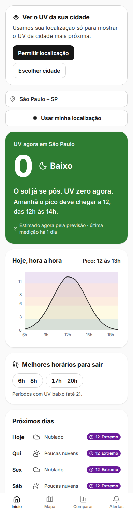
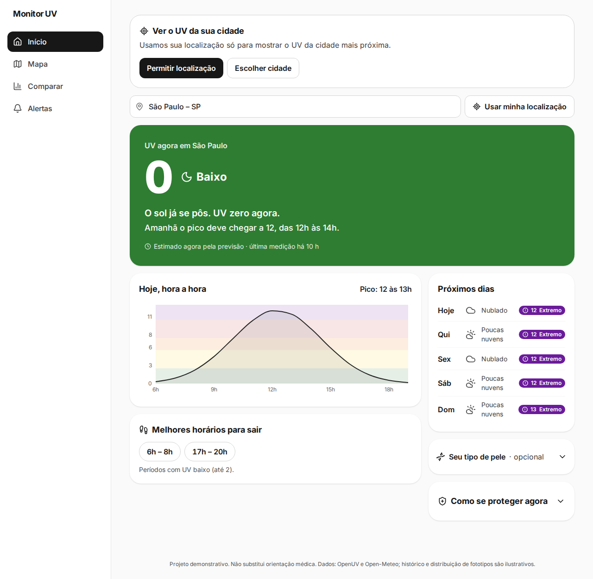
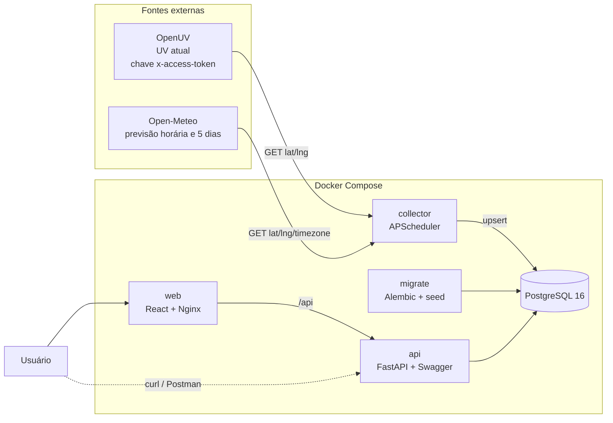
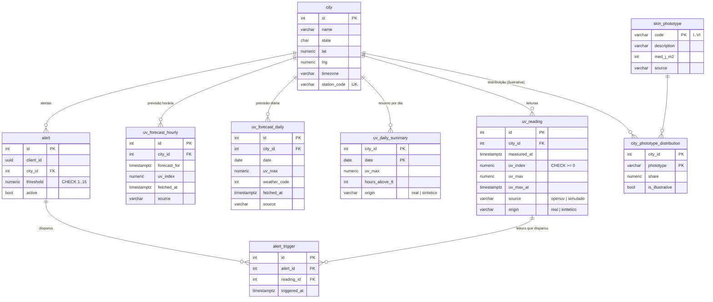
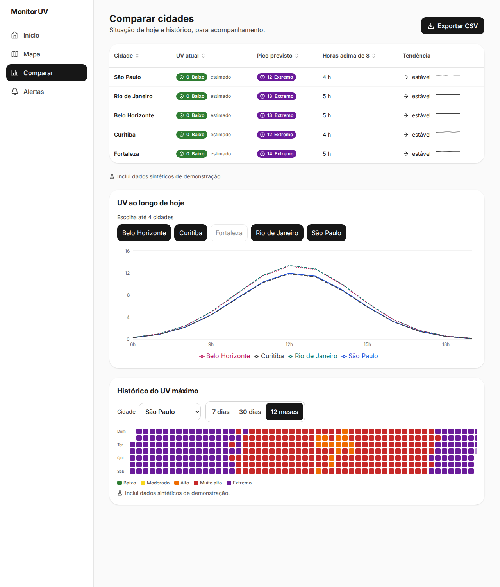
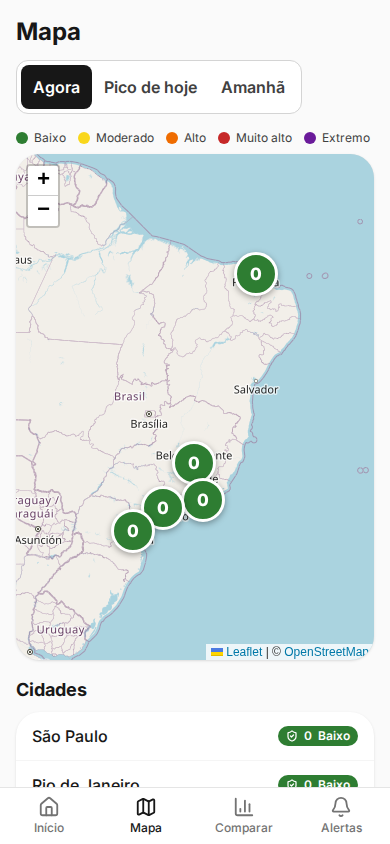

# Monitor UV

Coleta o **índice ultravioleta (UV)** de cinco capitais brasileiras numa API pública autenticada, guarda os dados em **PostgreSQL** e os expõe numa **API REST** documentada com Swagger. Uma interface web acessível consome essa API. Tudo sobe com um único `docker compose up`.

O projeto também liga o UV à **genética**: o tempo até a pele queimar depende do fototipo, uma característica com forte componente genético (por exemplo, variantes do gene *MC1R*).

<p align="center">
  
  &nbsp;
  
</p>

> **Projeto demonstrativo. Não substitui orientação médica.**

---

## Sumário

1. [Como rodar](#como-rodar)
2. [Acesso aos dados (API REST)](#acesso-aos-dados-api-rest)
3. [Arquitetura](#arquitetura)
4. [Modelagem do banco](#modelagem-do-banco)
5. [Extração de dados](#extração-de-dados)
6. [Interface web](#interface-web)
7. [Camada genética](#camada-genética)
8. [Decisões e trade-offs](#decisões-e-trade-offs)
9. [Testes e qualidade](#testes-e-qualidade)
10. [Estrutura do repositório](#estrutura-do-repositório)

---

## Como rodar

### Pré-requisitos

- Docker 24+ com Docker Compose v2.24+
- Portas livres: `8080` (interface), `8000` (API) e `5432` (banco). Todas podem ser trocadas no `.env`.

### 1. (Opcional) Chave da OpenUV

Crie uma conta gratuita em <https://www.openuv.io>, copie a chave de API e configure:

```bash
cp .env.example .env
# edite .env e preencha OPENUV_API_KEY=...
```

**Sem chave o projeto também funciona.** O coletor detecta a chave vazia, registra um aviso no log e usa o **provedor simulado**, que gera tanto o UV atual quanto a previsão. Todos os dados gerados assim ficam marcados como sintéticos: a API devolve `display_synthetic` / `synthetic`, e a interface mostra "dado simulado" no lugar de "medido".

### 2. Subir o ambiente

```bash
docker compose up -d --build
```

| Serviço     | O que faz                                                            |
|-------------|----------------------------------------------------------------------|
| `db`        | PostgreSQL 16 com volume persistente                                 |
| `migrate`   | Aplica as migrations (Alembic) e o seed idempotente, depois encerra  |
| `api`       | FastAPI em `:8000`                                                   |
| `collector` | Coleta agendada: UV atual e previsão                                 |
| `web`       | Interface React servida pelo Nginx em `:8080`, com proxy para `/api` |

### 3. Acessar

| O quê                  | URL                                  |
|------------------------|--------------------------------------|
| Interface              | <http://localhost:8080>              |
| Swagger (documentação) | <http://localhost:8000/docs>         |
| OpenAPI (JSON)         | <http://localhost:8000/openapi.json> |

Para acompanhar a coleta:

```bash
docker compose logs -f collector
```

Para parar e apagar os dados:

```bash
docker compose down -v
```

---

## Acesso aos dados (API REST)

Base: `http://localhost:8000/api/v1`. A mesma API também responde por `http://localhost:8080/api/v1`, via Nginx. Todas as respostas são JSON, com datas em ISO 8601 UTC.

### Exemplos com `curl`

```bash
# Cidades monitoradas (a busca ignora acentos)
curl -s "http://localhost:8000/api/v1/cities?q=sao"

# UV agora em São Paulo, com o tempo estimado até queimar para pele tipo II
curl -s "http://localhost:8000/api/v1/cities/1/current?phototype=II"

# Linha do tempo de hoje: pico e melhores horários
curl -s "http://localhost:8000/api/v1/cities/1/today"

# Leituras gravadas no banco, paginadas e filtradas
curl -s "http://localhost:8000/api/v1/readings?city_id=1&origin=real&page_size=5"

# Comparação entre cidades e exportação em CSV
curl -s "http://localhost:8000/api/v1/compare?city_ids=1,5"
curl -s -o comparativo.csv "http://localhost:8000/api/v1/compare/export.csv"

# Alertas (sem login: cada navegador manda um UUID no header X-Client-Id)
curl -s -X POST "http://localhost:8000/api/v1/alerts" \
  -H "X-Client-Id: 00000000-0000-4000-8000-000000000001" \
  -H "Content-Type: application/json" \
  -d '{"city_id": 5, "threshold": 8}'
```

### Endpoints

| Método | Rota | Descrição |
|---|---|---|
| GET | `/health` | Estado da API e do banco, e o provedor de UV em uso (`openuv` ou `simulado`) |
| GET | `/cities?q=` | Lista e busca cidades |
| GET | `/cities/nearest?lat=&lng=` | Cidade monitorada mais próxima ("usar minha localização") |
| GET | `/cities/{id}/current?phototype=` | UV agora: valor, nível OMS, recomendação, estado e tempo até queimar |
| GET | `/cities/{id}/today` | Previsão hora a hora (6h–19h), pico, melhores horários e horas com UV ≥ 8 |
| GET | `/cities/{id}/forecast` | Previsão de 5 dias com UV máximo e código do tempo |
| GET | `/cities/{id}/history?period=7d\|30d\|12m` | UV máximo diário, com indicação de dias sintéticos |
| GET | `/compare?city_ids=&date=` | Tabela comparativa e séries por hora (até 4 cidades) |
| GET | `/compare/export.csv` | Tabela comparativa em CSV no padrão do Excel pt-BR (`;`, vírgula decimal, UTF-8 com BOM) |
| GET | `/map?when=now\|peak_today\|tomorrow` | UV de todas as cidades para o mapa |
| GET | `/readings?city_id=&from=&to=&origin=&page=&page_size=` | Consulta bruta e paginada das leituras |
| GET/POST | `/alerts` | Lista e cria alertas (header `X-Client-Id`) |
| PATCH/DELETE | `/alerts/{id}` | Liga, desliga, altera ou exclui um alerta |
| GET | `/alerts/triggers?since=` | Disparos de alerta (padrão: hoje) |
| GET | `/phototypes` | Fototipos de Fitzpatrick e dose mínima para queimadura |

Toda resposta de UV já traz o nível da escala OMS (`level.key`, `level.label` e `level.recommendation`). Assim a regra de classificação existe num lugar só, o backend.

### Postman

Importe `docs/postman/monitor-uv.postman_collection.json`. A coleção tem 17 requisições, geradas a partir do OpenAPI, e as variáveis `baseUrl` e `clientId`.

---

## Arquitetura



- **Backend** (`backend/`): Python 3.12, FastAPI, SQLAlchemy 2, Alembic, httpx e APScheduler. Uma mesma imagem atende três comandos: `api`, `collector` e `migrate`.
- **Regras de domínio puras** (`app/domain/`): escala OMS, pico, melhores horários e qual valor mostrar como "agora". São funções que recebem `now` como parâmetro, o que permite testá-las sem relógio real.
- **Frontend** (`frontend/`): React, TypeScript, Vite, Tailwind CSS, Recharts, Leaflet e TanStack Query.

---

## Modelagem do banco



Por que o banco foi modelado assim:

- **Leitura medida separada de previsão.** Uma leitura é um fato observado; uma previsão é revisada a cada coleta. Com tabelas separadas, a API nunca apresenta um valor previsto como medido.
- **Upsert pelas chaves naturais.** As chaves `UNIQUE(city_id, measured_at, source)` e `UNIQUE(city_id, forecast_for, source)` permitem gravar com `INSERT … ON CONFLICT`. Rodar a coleta duas vezes não duplica nada.
- **Origem explícita.** `origin` (`real` ou `sintetico`) e `source` (`openuv`, `openmeteo` ou `simulado`) deixam claro de onde veio cada número. A API devolve `contains_synthetic` sempre que um período inclui dados de demonstração.
- **Resumo diário por dia local.** A chave de `uv_daily_summary` é `(city_id, date)`, e `date` é o dia **no fuso da cidade**: uma leitura às 22h30 em São Paulo conta para aquele dia, não para o dia seguinte em UTC. O dado real sempre vence o sintético.
- **Índice `(city_id, measured_at DESC)`.** Atende a consulta mais frequente, a última leitura de cada cidade.
- **Constraints no banco**, além da validação na API: `CHECK uv_index >= 0`, `CHECK threshold BETWEEN 1 AND 15`, `CHECK origin IN (...)`, chaves estrangeiras com `ON DELETE CASCADE`.
- **Migrations versionadas.** `0001_core` cria o núcleo e `0002_genetics` cria a camada genética. A camada genética fica separada para poder ser removida sem afetar o resto.

---

## Extração de dados

### OpenUV: fonte autenticada

```
GET https://api.openuv.io/api/v1/uv?lat={lat}&lng={lng}
x-access-token: {OPENUV_API_KEY}
```

- **Parâmetros dinâmicos:** `lat` e `lng` vêm da tabela `city`, uma requisição por cidade.
- **Autenticação:** a chave de API vai no header `x-access-token`, lida de variável de ambiente e nunca versionada.
- **Dados extraídos:** `uv` (atual), `uv_time`, `uv_max` e `uv_max_time` do dia.
- **Cota:** o plano gratuito permite **50 requisições por dia**. Com 5 cidades, o coletor consulta a cada **120 minutos, só entre 6h e 19h** no horário local, o que dá cerca de 35 chamadas por dia. Tudo é configurável no `.env`.
- **Erros:** falha de rede e respostas 5xx são repetidas até 3 vezes, com backoff exponencial (0,5 s, 1 s). Chave inválida (401/403) e cota estourada (429) **não** são repetidas, porque repetir só gastaria cota. Esses erros e as respostas malformadas viram log de aviso; as demais cidades continuam sendo coletadas e o processo segue rodando.

### Open-Meteo: previsão, sem chave

```
GET https://api.open-meteo.com/v1/forecast?latitude={lat}&longitude={lng}
    &hourly=uv_index&daily=uv_index_max,weather_code&timezone={tz}&forecast_days=5
```

Fornece a curva hora a hora de hoje e a previsão de 5 dias com o ícone do tempo, dados que a OpenUV gratuita não entrega. É coletada a cada 60 minutos.

### Modo simulado e histórico de demonstração

- `UV_PROVIDER=simulado`, ou a chave vazia, ativa uma curva em sino: UV 0 de madrugada, pico entre 11h e 13h, sazonalidade por latitude e Nordeste entre 11 e 14.
- Nenhuma API gratuita fornece 12 meses de histórico de UV. Por isso, na primeira subida o seed gera **12 meses de UV máximo diário e 30 dias de leituras horárias**, sempre **até ontem**. O seed é idempotente e nunca sobrescreve um dia que tenha dado real.

---

## Interface web

<p align="center">
  
  &nbsp;
  
</p>

O objetivo é que qualquer pessoa responda em até 5 segundos a pergunta **"posso ficar no sol agora?"**.

- **Início:** número grande, cor e frase da escala OMS; linha do tempo de hoje com as faixas da escala ao fundo e o marcador do "agora"; melhores horários para sair; previsão de 5 dias; dicas de proteção.
- **Mapa:** marcadores coloridos com o número do UV; filtro agora / pico de hoje / amanhã; painel inferior com o resumo da cidade.
- **Comparar** (gestores): tabela ordenável com tendência, gráfico com até 4 cidades, mapa de calor do histórico (7 dias, 30 dias, 12 meses) e exportação em CSV.
- **Alertas:** "me avise quando o UV passar de N em tal cidade", com interruptor por alerta e lista de disparos. Sem push nem e-mail: o aviso aparece na própria interface.
- **Estados:** carregando (skeleton), sem dados, estação desatualizada, noite (com o pico de amanhã), erro de rede com "Tentar de novo" e primeiro acesso pedindo a localização.
- **Acessibilidade (WCAG 2.1 AA):** a cor nunca é o único indicador (sempre há rótulo e ícone); o contraste de texto é ≥ 4.5:1, verificado por teste; os alvos de toque têm ≥ 44px; a navegação funciona por teclado, com link "Pular para o conteúdo"; a interface respeita `prefers-reduced-motion`.
- A escala de cores fica num único arquivo de tokens: `frontend/src/theme/uvScale.ts`.

---

## Camada genética

| Fototipo | Descrição | MED (J/m²) |
|---|---|---|
| I | Pele muito clara: sempre queima, nunca bronzeia | 200 |
| II | Pele clara: queima com facilidade, bronzeia pouco | 250 |
| III | Pele morena clara: às vezes queima, bronzeia aos poucos | 300 |
| IV | Pele morena: raramente queima, bronzeia com facilidade | 450 |
| V | Pele morena escura: muito raramente queima | 600 |
| VI | Pele negra: nunca queima | 1000 |

- **Tempo até queimar:** `minutos = MED / (UV × 0,025 W/m²) / 60`. Um índice UV equivale a 0,025 W/m² de irradiância eritêmica. Exemplo: tipo II com UV 10 dá 250 / 0,25 / 60 ≈ **17 min**.
- **Fonte dos valores de MED:** valores típicos citados na literatura de fotobiologia (Fitzpatrick, 1988; Diffey, 1991). Eles variam entre pessoas e entre estudos.
- **Vulnerabilidade estimada** (tela Comparar): pico previsto × proporção da população com fototipos I–III. A distribuição de fototipos por cidade é **ilustrativa** (`is_illustrative = true`), porque não existe base pública com fototipo por município. A interface e o CSV indicam isso.
- **Nenhum dado genético do usuário é coletado.** O fototipo, que é opcional, fica guardado só no navegador.

---

## Decisões e trade-offs

| Decisão | Motivo | Custo |
|---|---|---|
| Duas fontes (OpenUV + Open-Meteo) | A OpenUV atende o requisito de chave de API; a Open-Meteo cobre a previsão por hora e a de 5 dias | Duas integrações |
| Coleta a cada 120 min, só entre 6h e 19h | Respeita a cota gratuita de 50 chamadas por dia | O "UV agora" medido pode ter até 2h; entre coletas, a API mostra a **estimativa** da previsão, sempre rotulada como estimada |
| `stale` só dentro da janela de coleta | Evita marcar toda cidade como "estação offline" de madrugada | — |
| Medição de outro dia nunca vira "UV agora" quando há previsão | Se a coleta falhar de manhã, mostrar o "0" de ontem à noite ao meio-dia seria um conselho perigoso | — |
| Modo simulado quando falta a chave | O avaliador roda o projeto sem criar conta | Os dados ficam marcados como sintéticos |
| Histórico sintético até ontem, com o dado real sempre vencendo | O mapa de calor de 12 meses funciona desde o primeiro dia | Exige deixar a origem visível, o que a API e a interface fazem |
| Alertas sem login (UUID por navegador) | Escopo de teste técnico | Trocar de navegador perde os alertas |
| Nível OMS calculado no backend | Uma fonte de verdade para a regra | — |
| Versões travadas: `backend/requirements.lock`, `package-lock.json` com `npm ci`, imagens com tag de versão (Python 3.12, Node 24 LTS, Postgres 16) | Build reproduzível hoje e daqui a meses | Atualizar dependências exige regenerar o lock |

---

## Testes e qualidade

**Backend:** 92 testes com pytest, rodando contra um PostgreSQL real (banco `uv_test`), mais o ruff.

```bash
docker compose up -d db
cd backend
python -m venv .venv && . .venv/bin/activate
pip install -e ".[dev]"
ruff check . && pytest -q
```

Os testes cobrem os limites da escala OMS, a virada de dia no fuso de cada cidade, a chave da OpenUV no header e as coordenadas na URL (com HTTP mockado), os erros 401 e 429 sem derrubar o coletor, a idempotência do upsert e do seed, a prioridade do dado real, as regras de agora/estimado/noite/desatualizado, a paginação, a validação de entradas (404, 422 e 400) e o isolamento dos alertas por cliente.

**Frontend:** testes com Vitest e Testing Library, incluindo o contraste ≥ 4.5:1 de cada nível, os estados do card, o retry em erro de rede, a ordenação da tabela, o interruptor de alerta e o painel do mapa.

```bash
cd frontend
npm install
npm test
npm run build
```

O **CI** (`.github/workflows/ci.yml`) roda lint, as migrations (upgrade e downgrade) e os testes do backend com o serviço Postgres, além dos testes e do build do front.

---

## Estrutura do repositório

```
.
├── docker-compose.yml          # db, migrate, api, collector, web
├── .env.example                # variáveis documentadas (copie para .env)
├── backend/
│   ├── Dockerfile
│   ├── migrations/             # Alembic: 0001_core, 0002_genetics
│   ├── app/
│   │   ├── api/                # FastAPI: rotas, schemas, dependências
│   │   ├── collector/          # coleta agendada
│   │   ├── domain/             # regras puras: escala OMS, pico, "agora", curva sintética
│   │   ├── genetics/           # fototipos, tempo até queimar, vulnerabilidade
│   │   ├── providers/          # OpenUV, Open-Meteo, simulado
│   │   ├── seed/               # cidades e histórico sintético
│   │   └── services/           # consultas (cidades, comparação, alertas, resumo)
│   └── tests/
├── frontend/
│   ├── Dockerfile, nginx.conf
│   └── src/
│       ├── theme/uvScale.ts    # tokens da escala OMS (fonte única de cores)
│       ├── api/                # cliente, tipos e hooks
│       ├── components/         # UvCard, UvBadge, UvTimeline, UvMap, CityCompareTable…
│       └── pages/              # Início, Mapa, Comparar, Alertas
└── docs/
    ├── postman/                # coleção Postman
    ├── img/                    # capturas de tela
    └── superpowers/            # documento de design e plano de implementação
```
